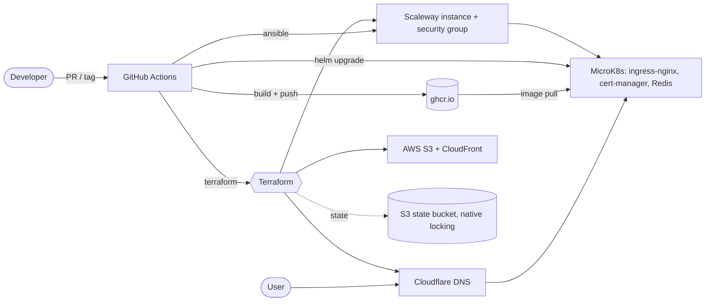

# microk8s-scaleway-platform

A small but complete cloud platform, built end to end with Infrastructure as Code: a single-node **MicroK8s** cluster on **Scaleway**, DNS and TLS through **Cloudflare** and **Let's Encrypt**, object storage behind **CloudFront** on **AWS**, and everything provisioned and deployed from **GitHub Actions**.

> This is a personal learning project. It started as the infrastructure behind a real website; the application code was removed and replaced with two tiny placeholder services (`apps/api`, `apps/web`) so the platform can be read and run on its own. It is not production-grade, and the [known limitations](#known-limitations--roadmap) are listed honestly below.

## Architecture

| Layer | Tooling | Where |
|---|---|---|
| Infrastructure | Terraform 1.11, one root module + 3 child modules, S3 backend with native locking | [infra/terraform](infra/terraform) |
| Configuration | Ansible roles: MicroK8s, cert-manager, RBAC, Redis, service-account kubeconfig | [infra/ansible](infra/ansible) |
| Packaging | Helm charts for `api` and `web`, one values file per environment | [infra/kubernetes/charts](infra/kubernetes/charts) |
| CI/CD | GitHub Actions: lint, image build, provision, deploy, release-please | [.github/workflows](.github/workflows) |
| Workloads | Placeholder Python API and nginx page, non-root, with healthchecks | [apps](apps) |

Environments: `dev`, `staging`, `production` (GitHub Environments). `production` serves the apex domain, others `<env>.<domain>`.

## Pipelines

| Workflow | Trigger | What it does |
|---|---|---|
| `ci-lint` | PR, push to `main` | terraform fmt/validate/tflint, helm lint + kubeconform on every env, ansible-lint, hadolint + image build, gitleaks, checkov |
| `ci-terraform-plan` | PR touching `infra/terraform` | posts the `dev` plan as a PR comment |
| `ci-release-please` | push to `main` | opens release PRs per app and tags `api-vX.Y.Z` / `web-vX.Y.Z` |
| `ci-api-image`, `ci-web-image` | those tags | build and push to `ghcr.io/<owner>/<repo>/<app>` |
| `cd-infra-provision-config` | manual | `terraform plan` then apply/destroy, Ansible, image-pull secret |
| `cd-api-deploy`, `cd-web-deploy` | manual | `helm upgrade --install --atomic` via the shared `reusable-deploy-k8s-app` |

## Deploying it yourself

1. **State bucket**: `cd infra/terraform/bootstrap && terraform init && terraform apply -var state_bucket_name=<unique-name>`, then put that name in `infra/terraform/envs/*.backend.hcl`.
2. **Configure** `infra/terraform/envs/<env>.tfvars` (domain, instance type) and replace `OWNER` in the chart `values.yaml` image repositories.
3. **GitHub Environments** `dev`, `staging`, `production` (add required reviewers on `production`) with the secrets and variables in [docs/secrets.md](docs/secrets.md).
4. Run **cd-infra-provision-config** (apply), push an `api-v*` / `web-v*` tag (or run the image workflows manually), then run **cd-api-deploy** / **cd-web-deploy**.

Local checks: `terraform -chdir=infra/terraform init -backend=false && terraform -chdir=infra/terraform validate`, `helm template t infra/kubernetes/charts/api -f infra/kubernetes/charts/api/values-dev.yaml`.

More detail in [docs/architecture.md](docs/architecture.md).

## Known limitations / roadmap

Things I know are not where they should be, in rough priority order:

- **Single node, single replica.** No HA, no backups; a MicroK8s node failure means downtime.
- **Kubeconfig travels as a GitHub artifact** (7 days). Better: OIDC or a bastion/VPN, or GitOps with Argo CD/Flux pulling from the cluster side.
- **SSH and the Kubernetes API default to `0.0.0.0/0`** (`admin_cidrs`). Fine for a demo, restrict it in `tfvars`.
- **Redis has auth disabled**, protected only by a NetworkPolicy.
- **Apply/destroy are gated by GitHub Environment reviewers**, not by a separate plan-approval step.
- **No observability stack yet** (Prometheus, Grafana, Loki planned).
- Helm chart for Redis and cert-manager manifests are not version-pinned everywhere; checkov and ansible-lint run in advisory mode.
- Tested by CI linting and validation; the full apply path needs your own Scaleway/AWS/Cloudflare accounts.

## What this project demonstrates

- Multi-environment Terraform with remote state, locking, modules and validation
- Provisioning-to-deployment automation with GitHub Actions (reusable workflows, environments, concurrency, least-privilege permissions)
- Kubernetes operations on MicroK8s: ingress, automated TLS with DNS-01, RBAC with a scoped service account, Helm packaging
- Supply chain basics: non-root images, healthchecks, secret scanning, semantic releases
